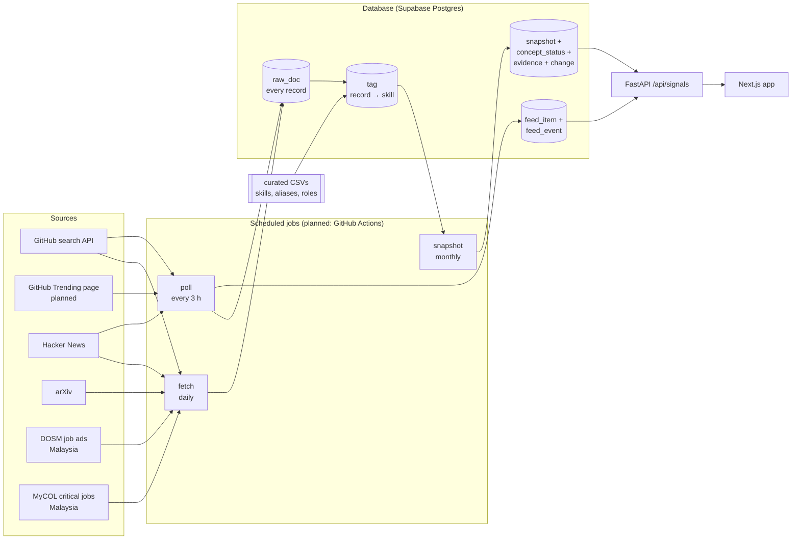

# How Kompas's data backend works

> Written 2026-10-23 from the code in `backend/pipeline/kompas/` and a read-only check of the Supabase database.
> It describes the backend **after** three planned changes, each marked **(planned)**:
> 1. a scheduled GitHub Actions job runs ingestion instead of a person;
> 2. a GitHub Trending poller finds repos our topic search misses;
> 3. the live feed's push stream reads from the database instead of from inside the server.
>
> Everything not marked (planned) exists today. Section 12 lists what is broken or missing **right now**. Read it
> before you build anything on top of this data.

---

## 1. The whole thing in one paragraph

Every day a scheduled job asks public sources (GitHub, Hacker News, arXiv, and Malaysia's DOSM and MyCOL) what's
new, and stores every answer in the database exactly as it arrived. It then reads each record and notes which
**skills** it mentions, using a hand-made dictionary. Once a month the job counts how often each skill appears in
each source, works out whether that count is rising unusually fast compared with its own past, and gives every
skill a **status** (Watch, Emerging, Act now, and so on). That set of statuses, together with the records behind
them, is frozen as a dated **snapshot**. Every screen in the app reads one snapshot: the 2028 view, the bets, the
learning route, and the "what changed" Ping. Separately, every few hours a lighter job checks what is hot on
Hacker News and GitHub right now and updates the **live feed**.



---

## 2. Words used in this document

| Word | Plain meaning | Where it lives |
|---|---|---|
| **Source** | A place we collect from: `github`, `hn_front`, `hn_hiring`, `arxiv`, `dosm_jmi`, `mycol` | `curated/sources.csv` |
| **Stream** | One kind of collection from a source. GitHub has two: monthly `counts` and the `live` poll | `config.STREAMS` |
| **Run** | One attempt to collect one stream, from start to finish. Every run is logged | table `fetch_log` |
| **Document** (record) | One thing we stored: an HN story, a repo, a paper count, a job post, a DOSM figure | table `raw_doc` |
| **Concept** (skill) | Something we score, e.g. `agentic-coding` or `data-visualisation`. Only the 45 listed concepts are ever scored | `curated/concepts.csv` |
| **Alias** | Another name for a concept, e.g. "Claude Code" → `agentic-coding` | `curated/concept_alias.csv` |
| **Tag** | "This document mentions this concept", plus how we know | table `tag` |
| **Period** | A month (`2026-09`) or, for DOSM, a quarter (`2026Q2`) | |
| **Rung** | How serious a signal is: **1** = people are building or talking about it (GitHub, HN, arXiv); **2** = companies are hiring for it (HN "Who is hiring?"); **3** = Malaysian employers are advertising for it (DOSM) | `sources.csv`, column `rung` |
| **Status** | A concept's position on the Signal Ladder: `Watch`, `Emerging`, `Act now`, `Stable`, `Declining`, `Stalled` | table `concept_status` |
| **Snapshot** | All 45 statuses, worked out as if it were a given date, frozen with the evidence behind them | tables `snapshot`, `concept_status`, `evidence`, `change` |
| **Evidence** | The actual records (links) behind a status, so every claim on screen can be clicked and checked | table `evidence` |
| **Feed** | Things gaining attention right now (HN stories, GitHub repos) that mention a concept | tables `feed_item`, `feed_event` |
| **Checkpoint** | A bookmark: "this stream is complete up to here" | table `checkpoint` |

---

## 3. When things run (planned schedule)

Today nothing runs on its own. Someone types the commands, or the API server polls while it's running with
`KOMPAS_LIVE=1`. The plan moves all of it into GitHub Actions, so it runs on GitHub's machines whether or not
anyone's laptop is on.

| Job | When (Malaysia time) | What it runs | Why this often |
|---|---|---|---|
| **Poll** | Every 3 hours | `kompas poll all`: current HN top stories, the most-starred new repos per GitHub topic, GitHub Trending (planned) | The feed is about "right now". A repo's stars-per-day needs two observations at least an hour apart within 48 hours, and every 3 hours gives several. |
| **Fetch** | Daily, 02:00 | `kompas fetch all`: every non-live stream, incrementally | Most days most streams answer "nothing new" (`no_change`), which is fine and cheap. HN stories and DOSM releases can appear any day. |
| **Snapshot** | Monthly, on the 2nd, after that day's fetch | `kompas snapshot --as-of YYYY-MM-01 --export`, then commit the JSON copy to the repo | Statuses only change when a whole month of data is complete (section 7), so a daily snapshot would just repeat itself. The JSON copy is the offline fallback. |
| **Health check** | At the end of every job | `kompas status --live` | Exits with an error if any stream is stale, failing or never run. The Actions job then fails, and GitHub emails the repo owner. `--live` matters: without it the poll streams aren't expected to be running, so a dead poll would never be reported. |
| **Manual imports** | When DOSM or TalentCorp publish | A person saves the file to `backend/data/manual/`, then runs `kompas fetch dosm_jmi --stream occupations` or `kompas fetch mycol` | These sources publish files, not APIs (section 4.5). |

**Cost.** The repo is private, so GitHub Actions gives 2,000 free minutes a month. A poll takes roughly 3–4
minutes, mostly because 78 GitHub topics have to be queried at GitHub's limit of 30 searches a minute. By that
estimate, polling every 3 hours plus the daily fetch comes to about 1,100–1,300 minutes a month. Hourly polling
would go over the limit. These are estimates, not measurements, so check the Actions usage page after the first
week.

**GitHub cron isn't exact.** Scheduled runs can start several minutes late when GitHub is busy, and occasionally
one is skipped. Nothing breaks when that happens: the next run carries on from the checkpoint (section 4.6).

---

## 4. Step 1: Fetch (collecting from sources)

### 4.1 What we collect from each source

| Source / stream | What we ask for | What we store | What it can't see |
|---|---|---|---|
| **arXiv / monthly** (rung 1) | For each month: how many AI papers there were in total (cs.AI, cs.CL, cs.LG, cs.CV), and how many match each concept's search phrases | One "total" record per month (`axb:`), one count per concept per month (`axc:`), and the top 3 papers (`ax:`) as evidence | Only 12 of the 45 concepts have search phrases. Research activity isn't jobs. |
| **GitHub / counts** (rung 1) | For each of the 78 tracked topics: how many public repos with that topic were created each month | One count per topic per month (`ghc:topic:month`) | Repos without topic tags are invisible. A repo tagged later or deleted shifts old counts slightly (we keep every re-count, see 4.3). |
| **GitHub / live** (feed) | For each topic: the 10 most-starred repos created in the last 30 days | Each repo (`gh:owner/name`), plus a timestamped star count each time we look | The same topic blind spot. |
| **GitHub / trending** (planned) | The `github.com/trending` page | The same `gh:owner/name` records (so a repo found both ways is stored once) plus a star observation | It's a scraped web page: if GitHub changes the HTML, the run fails loudly (section 11). Used for discovery and the feed only, never for trend scores. |
| **HN / backfill** (rung 1) | Every story with 100+ points, one week at a time, via the Algolia search API | Each story (`hn:id`) with points and comment count | English-language, tech-heavy, mostly US audience. |
| **HN / live** (feed) | The current top 60 stories from the official HN API | Same records, points updated | |
| **HN / hiring threads** (rung 2) | Every top-level comment in each monthly "Ask HN: Who is hiring?" thread; one comment = one job post | Each post (`hnh:id`), with email addresses replaced by `[email]` and usernames not kept | Tech jobs only, mostly US/EU/remote. That is why rung 2 is empty for non-tech skills. |
| **DOSM / groups** (rung 3, context only) | DOSM's official quarterly workbooks: online job ads per *major* occupation group (e.g. "Professionals") | One figure per group per quarter | Too broad to stand for any one skill, so it isn't used for scoring. |
| **DOSM / occupations** (rung 3) | A CSV a person builds from DOSM figures: job ads per 4-digit occupation per quarter (e.g. 2411 Accountants) | One figure per occupation per quarter | DOSM shows these only in its interactive portal, so they can't be fetched automatically. |
| **MyCOL / editions** | Malaysia's Critical Occupations List PDF, saved by hand | Which occupations are officially "critical" and their shortage indicators | One judgement per edition, not a trend. Used to boost "Rising" bets for critical jobs and to check our occupation codes. |

Separately, **JSearch** (job postings for the "Open jobs" panel) is fetched on demand when a user opens a role,
cached for a day, and never scored. It isn't part of this pipeline.

### 4.2 Every run is recorded honestly

Each run writes a row to `fetch_log` with one of these results:

| Result | Meaning |
|---|---|
| `ok` | New or changed records were stored, and nothing went wrong |
| `no_change` | The source answered, and there was nothing new. **This is normal**, not a failure |
| `partial` | Some records were stored, but something was missing (e.g. the source said "1,200 results" and gave us 1,000). The reason is written down |
| `failed` | Nothing could be stored (source down, blocked, rate-limited) |
| `invalid` | A file failed validation (e.g. a DOSM CSV with a duplicate row), so **none** of it was stored |
| `interrupted` | The process was stopped mid-run. What was already saved stays, and the next run continues from there |

It also counts how many records were fetched, inserted, updated, unchanged, skipped or failed, and how many retries
were needed. Single bad records go to `ingest_error` with the reason; they don't stop the run.

This is the main difference from trend-monitor, which returns an empty list on any error. A dead source there
looks exactly like a quiet day. Here a dead source shows up as `failed` or `stale`.

### 4.3 How a record is stored

- **Every record has a fixed ID per source** (e.g. `hn:41234567`). Fetching the same thing again updates that
  record and never creates a duplicate. Running a fetch twice is therefore always safe.
- **Every record must say when it became public** (`published_at`, in UTC). A record with no date, or a date with
  no timezone, is refused rather than guessed. This date never changes after the first save.
- **Monthly counts count as public at the start of the next month.** September's count is public on
  1 October 00:00 UTC, because nobody could have known it before September ended.
- **DOSM releases count as public at the end of their release day, Malaysian time**, because DOSM gives only the
  date, not the hour. That errs late, never early.
- **Changing numbers are kept as history, not overwritten.** Star counts, HN points and GitHub re-counts each go
  into `artifact_metric` with the time we saw them. A snapshot dated March only uses star counts we observed
  before March.
- **The raw answer is kept** (`raw_payload`), minus fields we choose not to keep (owner avatars, recruiter emails).

### 4.4 When a source misbehaves

- **Spacing:** each source has a minimum gap between requests: arXiv 3.1 s, GitHub search 2.1 s with a token,
  HN 0.2–0.5 s.
- **Retries:** network errors, timeouts, HTTP 429 and 5xx errors are retried up to 4 times (arXiv 6), with
  growing, randomised waits. If the source says how long to wait (`Retry-After`, GitHub's rate-limit reset), we
  wait that long.
- **No hanging:** if a source asks us to wait more than 5 minutes, the request fails as `rate_limited` instead of
  hanging. The run stops, and the next scheduled run picks up.
- **Circuit breaker:** three failed requests in a row mean the source is down, so the run stops instead of
  failing every remaining request the same way.
- **Client errors** (other 4xx) aren't retried, because asking again won't help.

### 4.5 Manual files (DOSM occupations, MyCOL)

Some official data only comes as files a person downloads. The rules for these files:

- They live in `backend/data/manual/`, as described in that folder's README.
- **A DOSM CSV is checked in full before anything is stored:** columns, quarter format, release dates,
  duplicates, negative numbers, and occupation codes we can't map. Any error rejects the whole file (`invalid`).
- **A missing value is never read as zero.** The row is left out and reported, because a fake zero would look
  like a collapse in demand.

### 4.6 Never losing our place

- **Checkpoints:** after each fully fetched month (or HN week), the stream's checkpoint moves forward, in the
  same database transaction as the data itself. So a checkpoint can never point past data that isn't stored.
- **Overlap:** each incremental run re-fetches a little of the past, to pick up late arrivals: 1 month for arXiv,
  GitHub and hiring threads, and 3 days for HN, because points settle within days. A hiring thread is re-fetched
  until it's 35 days old, because people keep posting to it.
- **Locks:** only one process can run a given stream at a time. A second one gets `busy` and leaves. If a process
  dies, its lock expires by itself after 30 minutes (`kompas unlock` frees it sooner).
- **After a crash, run the same command again.** Saved batches are kept, the checkpoint says where to continue,
  and re-fetched records just update themselves.

---

## 5. Step 2: Store (the database)

Production data is in **Supabase Postgres**: `DATABASE_URL` is set in `backend/.env`. If you set
`KOMPAS_DB=path` instead, everything uses a local SQLite file. Both get exactly the same tables, created from one
definition in `db.py`, and `kompas copy-to-postgres` copies local data up.

| Table | What's in it | Written by | Read by |
|---|---|---|---|
| `raw_doc` | Every record from every source | fetch, poll | tagging, counting, evidence, feed |
| `artifact_metric` | Star counts, points and re-counts, each with the time we saw it | fetch, poll | feed momentum, evidence |
| `tag` | Record → concept links | tagging | counting, feed, evidence |
| `snapshot`, `concept_status`, `evidence`, `snapshot_feed`, `change` | Each frozen snapshot and how it differs from the one before | snapshot | the whole app |
| `feed_item`, `feed_event` | The current live feed, and a log of every "new" or "rising" event | poll | `/feed`, `/feed/stream` |
| `fetch_log`, `ingest_error`, `checkpoint`, `ingest_lock` | Run history, failures, bookmarks, locks | every run | `kompas status`, `/health` |
| `alias_suggestion` | Aliases suggested by Gemini, waiting for a person to approve them | `kompas suggest` | `kompas approve`/`reject` |
| `job_cache` | JSearch answers, kept for 24 hours | the Open jobs panel | the Open jobs panel |
| `meta` | Schema version, which dictionary version was last used for tagging | migrations, tagging | |

**Nothing about users is stored.** CVs are read, turned into a list of skills and thrown away. The user's journey
(skills, chosen role, completed steps) lives in their browser. The server only ever receives it inside a request.

---

## 6. Step 3: Tag (which skills does this record mention?)

**No AI is used for tagging.** It's plain matching against our own tables, so the same record always gets the same
tags and every tag can be explained.

For each record that is new or has changed since it was last tagged:

1. **Topics** (GitHub repos only): if the repo's topics include one of a concept's `github_topics`, it's tagged.
   Topics written as `~topic` count for trends but are too generic to put an item in the feed.
2. **Dictionary and aliases:** the title and text are searched for each concept's label and every alias in
   `concept_alias.csv` (146 today), as whole words. Longest match first, so "Claude Code" wins over "Claude".
   Short or everyday words ("Rust", "RAG") are marked case-sensitive so "rust on my bike" doesn't count.
3. **Pre-assigned:** some records already belong to a concept because of how we asked. An arXiv count for
   `agentic-coding` is, by definition, about `agentic-coding`.

Each tag records **how** it matched (`topic`, `dictionary`, `alias`, `query`) and **the exact words** it matched,
so a wrong tag can be traced to the alias that caused it.

**When the dictionary changes, everything is re-tagged.** Editing a curated CSV changes its version fingerprint,
and the next tagging run re-reads every record.

**Popular items that match nothing** are listed by `kompas review`. `kompas suggest` asks Gemini to propose an
alias for them, but a suggestion only becomes real after automatic checks (the alias must actually appear in the
item, and must not tag a flood of unrelated items) **and** a person running `kompas approve`.

---

## 7. Step 4: Count (turning records into a monthly number per skill)

For each concept and each source, we build one number per period: **the concept's share of that source**.

| Source | The number for one month |
|---|---|
| HN stories | Stories with 100+ points that mention the concept ÷ all stories with 100+ points |
| HN hiring | Job posts that mention the concept ÷ all job posts that month |
| GitHub | New repos with the concept's topics ÷ new repos across all 78 tracked topics |
| arXiv | Papers matching the concept ÷ all papers in the four AI categories |
| DOSM | Job ads for the occupations that need this skill, weighted (essential 1.0, optional 0.5) ÷ all job ads that quarter |

**Why a share and not a raw count?** HN might simply have a busier month, or arXiv might grow overall. A share
rises only if *this* skill takes a bigger slice. The raw count is kept too, because it's used for the minimum-volume
rule in section 8.

**Only complete, public periods are used.** A snapshot dated 1 October sees September (public 1 October 00:00 UTC)
but not the first days of October. That's why a snapshot dated 21 October gives exactly the same statuses as one
dated 1 October.

**How DOSM reaches a skill:** a DOSM figure is per occupation (MASCO code). `occupation_code_map.csv` translates
MASCO codes to international ISCO codes, and `concept_occupation.csv` says which occupations need which concepts.
An occupation code we can't map still counts in the total; it just doesn't count towards any skill.

---

## 8. Step 5: Score (is it really rising?)

### 8.1 Trend: is this month unusual compared with this skill's own past?

1. **Smooth:** average each month with the one before it, so one odd month doesn't decide everything.
2. **With at least 4 earlier months:** compare this month with the previous up to 8 months.
   `trend = (this month − the average) ÷ how much it normally varies`. So `+1.5` means "1.5 times further above
   normal than a usual month's wobble". (It's a z-score. In the UI it should read "rising fast", not "+1.5".)
   The "normal wobble" is never taken as less than 10% of the average, so a flat series doesn't make a tiny change
   look huge.
3. **With fewer than 4 earlier months:** use simple growth on the previous month, and mark it **low confidence**.

### 8.2 Is the rung lit (active)?

A source lights its rung when **both** of these hold:

- **The trend is high enough:** +1.5 or more, or with low confidence, +50% on last month.
- **There's real volume:** at least 5 mentions this month (count sources), or at least 0.5% of all job ads (DOSM).
  This stops "2 mentions → 4 mentions = +100%" from counting as a trend.

A source counts as **falling** when the trend is −1.5 or lower (low confidence: −33%) **and** the skill had real
volume at some point. A skill can't decline from nothing.

A rung is lit if **any** of its sources is lit. We record which ones were.

### 8.3 Status: the first rule that matches wins

| # | Rule | Status |
|---|---|---|
| 1 | Hiring (rung 2) is falling, or Malaysian demand (rung 3, the skill's own) is falling | **Declining** |
| 2 | Malaysian demand (rung 3, the skill's own) is lit | **Act now** |
| 3 | Hiring (rung 2) is lit | **Emerging** |
| 4 | Building/talk (rung 1) is lit | **Watch**, or **Stalled** if rung 1 has been lit for 9 periods in a row while rung 2 never lit |
| 5 | None of the above | **Stable** |

Buzz alone (rung 1) can never make a skill more than **Watch**. That's the "hype or real?" idea behind the ladder.

### 8.4 Borrowing from the family

Many skills have no Malaysian figures of their own, because DOSM counts occupations, not skills. In that case the
skill **borrows** rung 3 from its nearest parent concept that has figures (e.g. `agentic-coding` from "Software
development"). It's labelled `level: family` and shown as "Software development · Act now". **A borrowed rung can
never make the skill itself "Act now".** It only sets the separate `family_status`.

### 8.5 Projection to 2028 (the Ghost CV)

For `Watch` and `Emerging` skills we estimate where they'll be by the end of 2028. We assume each step up the
ladder takes 6 quarters at today's pace, or 3 quarters if "AI moves fast".

*Example, from October 2026 (about 9 quarters before the end of 2028):*

| Scenario | Lead time per step | Steps up | `Watch` becomes |
|---|---|---|---|
| Moderate | 6 quarters | 1 | `Emerging` |
| Fast | 3 quarters | 3 (capped at the top) | `Act now` |

**These lead times are documented defaults, not measurements**, and the UI must call them estimates. Every scoring
setting is saved inside each snapshot (`params`), so any snapshot can be recomputed and explained later.

---

## 9. Step 6: Snapshot (freezing the result)

`kompas snapshot --as-of 2026-10-01` does all of this in one go:

1. Re-tags anything new (section 6).
2. Counts (section 7) and scores (section 8) using **only** records public before 2026-10-01 00:00 UTC.
3. **Collects evidence** for each concept: the actual records behind its rungs in the latest one or two periods.
   That means the top 3 HN stories by points, 3 recent job posts, the GitHub count with up to 3 repos (with star
   counts as seen before the date), the arXiv count with 3 papers, and the 4 largest DOSM occupations. This is
   what the "Ladder evidence" panel shows.
4. **Freezes the feed** as it was at that moment (`snapshot_feed`).
5. Saves it all under the ID `2026-10-01`. Re-running the same date replaces that snapshot completely.
6. **Compares it with the previous snapshot** and writes every change of status, family status or projection to
   `change`, with the reason (e.g. "rung 2 activated (hn_hiring)") and the evidence. This feeds The Ping.
7. With `--export`, also writes the same data as JSON files in `backend/data/snapshots/2026-10-01/`. In the
   planned monthly job these are committed to the repo as the offline fallback.

**Rebuilding old snapshots.** `kompas snapshot --monthly 2026-01 2026-10` builds one snapshot per month, as if each
were built on that date. The rules in sections 4.3 and 7 stop it from seeing records published later. It does,
however, use **today's** dictionary and **today's** latest re-counts. The planned monthly job therefore builds only
the new month and leaves older snapshots alone (section 12, item 6).

---

## 10. The live feed (what's hot right now)

Separate from the monthly scoring, the poll job keeps a ranked list of items gaining attention right now.

**What can get in:**

- **HN stories:** posted in the last 48 hours, with at least 100 points, and the title must name a concept.
- **GitHub repos:** created in the last 30 days, with at least 200 stars, gaining at least 25 stars a day, and the
  topics or name must match a concept.

**Momentum:**

- **HN:** points per hour since posting. Two hours are added to the age, so a five-minute-old post with 50 points
  doesn't top the list.
- **GitHub:** stars gained per day between our observations in the last 48 hours. With only one observation:
  stars per day since the repo was created.

Points and stars can't be compared with each other, so each source is scaled 0–1 against its own top item. The
top 50 make the feed.

**Events:** each poll compares the new list with the last one. An item that's new to the list gets a `new` event;
one whose momentum jumped by 25% or more gets a `rising` event. Events are appended to `feed_event` and never
edited.

**How events reach the browser:**

- **Today:** only the server process that did the polling can push its events to browsers, through an in-memory
  channel. When the server reloads, polling stops, and the live stream goes quiet.
- **(planned)** Polling moves to the scheduled job, so the server will instead check `feed_event` every few
  seconds and push anything newer. This change is required: without it, moving polling out of the server
  silences the live stream.
- **Either way:** a browser that reconnects sends the last event number it saw and gets everything it missed
  (up to 200). Demo replay mode (`KOMPAS_REPLAY=1`) re-plays recorded events in a loop, so a demo always shows
  movement.

---

## 11. How the app uses all this

**Unless a request names a snapshot, everything uses the latest one.** If no snapshot exists, the signal
endpoints answer HTTP 503.

| App part | Endpoint | What it reads |
|---|---|---|
| CV upload → skills | `POST /profile/extract` | Gemini reads the CV, and every skill it reports must quote the CV word for word. Without a Gemini key, keyword matching against the same aliases is used. The CV isn't stored. |
| The whole journey (Mirror, 2028 view, Bets, Route) | `POST /journey` | Latest snapshot statuses, curated role and task tables, MyCOL flags. The same profile, snapshot and scenario always give the same answer. |
| Role sparklines | inside `/journey` | Each role's demand across **the last 6 snapshots**. That's why snapshots should be monthly: six daily ones would cover a week and look flat. |
| The Ping | `POST /journey/ping` | Builds the journey for two snapshots and lists what moved: skill statuses, bets, route order, Ghost CV slots, AI exposure. |
| Plain-language briefs | `POST /journey/brief` | Gemini rewrites the computed facts. The text is rejected (and a fixed template used) if it mentions any number, role or skill that isn't in the facts. |
| Ladder evidence panel | `GET /concepts/{id}/evidence` | That snapshot's `evidence` rows |
| Live feed | `GET /feed`, `GET /feed/stream` | `feed_item`, plus events as they happen |
| Feed matched to the user | `POST /match` | Feed items scored against the user's skills, route and AI-exposed tasks |
| Open jobs | `GET /jobs` | JSearch, cached for 24 hours |
| Health | `GET /health` | The same report as `kompas status`, per source |

---

## 12. Current state (checked 2026-10-23), and what's broken

Data in Supabase today:

| Source | Records | Last success | State |
|---|---|---|---|
| HN stories | 15,883 | 2026-10-21 | ok |
| HN hiring posts | 3,789 | 2026-10-21 | ok (latest thread 2026-09) |
| GitHub counts | 936 (78 topics × 12 months) | 2026-10-21 | ok |
| GitHub repos (live) | 706 | 2026-10-22 | **stale**. The last 7 runs were `interrupted`, almost certainly by the dev server reloading mid-poll |
| arXiv | 571 (12 months; 12 concepts) | 2026-10-21 | ok |
| DOSM / groups | 289 (2019Q3–2026Q2, 9 major groups + total) | 2026-10-23 | ok. Imported after this check, see the update below |
| **DOSM / occupations** | **0** | never | **never run** (no `dosm_jmi.csv`) |
| **MyCOL** | **0** | never | **never run**, although the PDF and manifest are already in `data/manual/` |

There are 11 snapshots (one per month from 2026-01-01, plus 2026-10-21), all built on 2026-10-21. They contain
11,228 tags and 285 recorded changes.

> **Update, 2026-10-23 evening.** DOSM's release workbooks were imported (`kompas fetch dosm_jmi --stream groups`)
> and every snapshot was rebuilt. Each skill linked to an occupation (39 of 45) now has a "Hired in Malaysia" signal
> at **group level** (`level: "group"`): its occupation groups' share of all online job openings, from
> `aggregate.build_group_series`. It is shown on the skill cards and in the "Malaysian job market" panel
> (`journey.malaysia_market`), but it is never active or declining, so **it can't change a status**. Item 1 below
> still holds for statuses: "Act now" needs per-occupation figures (`dosm_jmi.csv`).

**What this means:**

1. **Every one of the 495 concept statuses (45 concepts × 11 snapshots) is something other than "Act now", because
   no Malaysian job data has been loaded.** "Act now" requires rung 3 (DOSM occupation figures), and that table is
   empty. The family borrowing has nothing to borrow either. Today the best any skill can reach is **Emerging**,
   and only for tech skills, because rung 2 is HN hiring. The app's footer says "Malaysian demand from DOSM and
   MyCOL", which is not true of the current data. **Fix first:** import MyCOL now (`kompas fetch mycol`; the file
   is already there), run `kompas fetch dosm_jmi --stream groups`, and build `data/manual/dosm_jmi.csv` from DOSM
   figures for the occupations in `occupation_code_map.csv`. Then rebuild the snapshots.
2. **Without MyCOL, the "+10% for critical occupations" boost on Rising bets never applies.**
3. **Non-tech skills (the finance/ops persona, Aisyah) have almost no signal.** Rung 1 is developer and research
   sources, rung 2 is tech hiring, and rung 3 is empty. So most of them sit at `Stable` by default, which doesn't
   mean "we checked and it's flat". Until DOSM is loaded, Aisyah's journey is driven mostly by defaults.
4. **Only 12 of the 45 concepts have arXiv search phrases**, so the other 33 get no research signal at all.
5. **The live streams are stale**, because polling only happens inside a running dev server, and reloads interrupt
   it. The planned scheduled poll fixes this.
6. **The historical snapshots were all built after the fact with today's dictionary.** Nothing published later
   leaks in (dates are enforced), but the *choice* of concepts and aliases was made with today's hindsight, and
   GitHub/arXiv counts are today's re-counts. For the Ping demo this is acceptable and the PRD allows it. From now
   on, the monthly job freezes each month as it happens. Don't re-run `--monthly` over old months unless you mean
   to rewrite history.
7. **Nothing runs on its own yet**, and there's no offline copy (`data/snapshots/` is empty). If Supabase is
   paused or unreachable, the app has no data. Both are fixed by the planned jobs.

---

## 13. What happens when something goes wrong (after the planned changes)

| Situation | What happens | Does the app keep working? | How we find out |
|---|---|---|---|
| A source is down for a day | Its run is `failed`; the others run normally | Yes. The latest snapshot is unchanged | `status` shows `unavailable` after consecutive failures, the job fails, GitHub emails us |
| A source rate-limits us | Waits and retries; if asked to wait more than 5 minutes, the run stops | Yes | Run shows `failed`/`partial` with category `rate_limited` |
| A source returns less than it says exists | Stored, run marked `partial` with the reason; that month isn't checkpointed, so it's fetched again next run | Yes | `kompas errors` |
| The job is killed mid-run | Saved batches stay; the run is `interrupted`; the next run continues from the checkpoint | Yes | `status` shows "last run was interrupted" |
| Two runs of the same stream overlap | The second gets `busy` and exits | Yes | Exit code 3 |
| A bad DOSM CSV is imported | Rejected as a whole (`invalid`); nothing stored | Yes, with the previous data | `status` shows `invalid`; `kompas errors` lists every problem |
| GitHub changes the Trending page (planned stream) | The parser finds nothing, so the run is `failed`, not "0 trending repos" | Yes. The feed still has the topic poll and HN | `status` |
| GitHub Actions skips or delays a run | Nothing is lost; the next run covers the gap (overlap windows) | Yes | `status` shows `stale` only if the gap passes a stream's limit (6 hours for GitHub live, 2 hours for HN live, ~35 days for monthly streams) |
| Supabase is unreachable | API calls fail | **Planned:** the frontend falls back to the last committed snapshot JSON and says "Market data as of …" | `/health` fails |
| A wrong alias tags the wrong items | Statuses shift for that concept | Yes, but wrong | Every tag stores the words that matched; fix the CSV, and the next snapshot re-tags everything |

---

## 14. Everyday commands

Run from `backend/`:

```bash
.venv/bin/kompas status                 # is every stream healthy? (exit 1 if not)
.venv/bin/kompas errors                 # recent failed records and validation findings
.venv/bin/kompas fetch all              # incremental fetch of every source
.venv/bin/kompas fetch arxiv --since 2025-10 --until 2026-09   # backfill a range
.venv/bin/kompas fetch all --dry-run    # fetch and validate, store nothing
.venv/bin/kompas poll all               # one live poll (HN + GitHub), then tag and re-rank the feed
.venv/bin/kompas snapshot --as-of 2026-11-01 --export          # build one snapshot (+ JSON copy)
.venv/bin/kompas diff 2026-09-01 2026-10-01                     # what changed between two snapshots
.venv/bin/kompas review                 # popular items that matched no skill
.venv/bin/kompas suggest / suggestions / approve / reject       # alias suggestions (a person decides)
.venv/bin/kompas validate               # check the curated CSVs
.venv/bin/kompas ilo-sync               # load the ILO's AI exposure scores per ISCO-08 task (section 15)
.venv/bin/kompas ilo-links              # link each catalogue job's ILO tasks to the tracked AI capabilities
.venv/bin/kompas requirements [--isco 2411 2512]   # measure roles' skills from live Malaysian postings
.venv/bin/kompas unlock <source> <stream>                       # free a lock left by a killed process
```

Exit codes from `fetch`: `0` ok, `1` failed/invalid/interrupted, `2` partial, `3` busy.


---

## 15. Reference data the LLM reads (added 2026-10-24)

The curated CSVs above are a small, fixed vocabulary: 45 concepts and 18 roles. Four kinds of real data now sit
beside them **in the database**, and the LLM reads them, cites them and is checked against them. It never makes up
a score, and nothing new is hand-curated.

| Data | Table | Filled by | Used for |
|---|---|---|---|
| **ILO generative-AI exposure index** (Gmyrek et al. 2025, CC BY 4.0): 3,264 ISCO-08 tasks of 427 occupations, each scored 0–1 | `ilo_task` (origin `ilo`) | `kompas ilo-sync` | The Mirror's task cards and every role's "AI and this job" share. Any of the 427 jobs can be picked, not only the 18 roles |
| **Jobs the index doesn't describe** (a CV's "TikTok content creator") | `ilo_task` (origin `llm`, with `basis`) | CV upload (`exposure.estimate`) | The LLM writes the job's tasks and scores each against 2–4 ILO tasks it must cite. A score outside their range is dropped. Stored once per job |
| **What Malaysian postings ask for**: the role's live JSearch postings, skills quoted from each posting | `role_requirement` | `kompas requirements`, and in the background when a user opens a role's jobs or picks their own job (weekly) | A role's skills and weights: essential if at least half the postings ask, optional if a fifth do. Replaces `concept_occupation.csv` for that role when there are 5+ postings with descriptions |
| **ESCO skills** for anything outside the 45 concepts | `open_skill`, `esco_lookup` | CV upload and posting reads: ESCO's search API returns candidates, the LLM picks the same skill or none | CV skills and posting skills share ESCO ids, so they match each other |
| **Signal Ladder for ESCO skills** | `open_status` | On request, once per snapshot (`open_signal.measure`) | The same rules as section 8, run over HN stories (rung 1) and HN hiring posts (rung 2) searched for the skill's names. No Malaysian rung: DOSM publishes per occupation |
| **Task → AI capability links** and **written reasons** | `narration` | The LLM, once per job / per evidence pack | Links: which tracked capability a task relies on. Reasons: the fit, demand, trend and AI reasons, rewritten from cited evidence, with the citations stripped before display |

**How The Mirror scores a task now.** Start from its ILO score. Add +0.15, +0.1 or +0.05 while the AI capability
it relies on is Act now, Emerging or Watch: today's status for "today", the projected one for "by 2028" (current
pace) and "if AI moves fast". Under "fast", also multiply by 1.3 (PRD 8.7), capped at 1. A task is exposed from 0.5,
the ILO's boundary. The lifts and ×1.3 are documented defaults, not measurements.

**How a reason gets written.** For each suggested job, `narrate.pack()` collects the facts and the evidence (the
person's skills and CV quotes, what the postings ask for, the hiring and trend records, the ILO scores), each with
an id. The LLM must end every sentence with the ids it rests on. `narrate.check()` rejects a reason that cites an
unknown id, uses a number that isn't in the pack, names a role or skill outside it, or states a status in words no
evidence uses. A rejected reason keeps its template. The CV upload waits for the reasons. The journey answers with
the templates and writes the reasons in the background for the next request, so its toggles stay instant.
